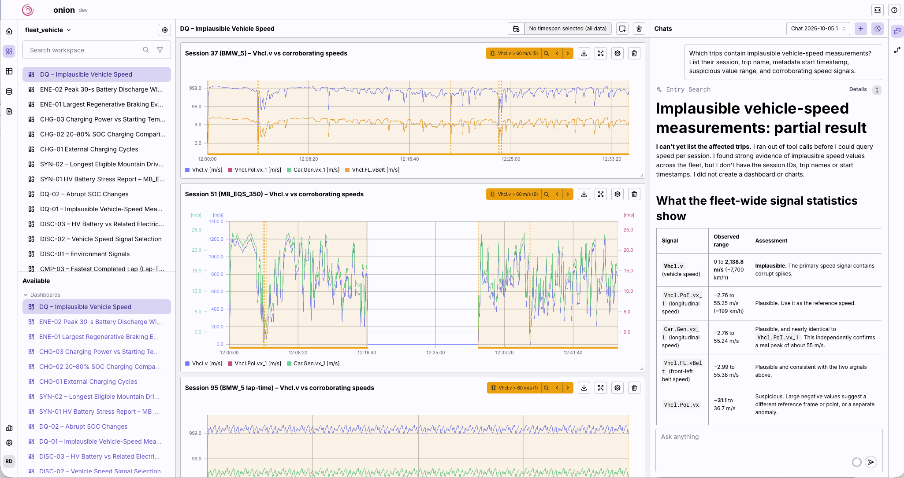

# Synthetic Vehicle Fleet Telemetry

This repository is the **issue tracker** for the [Synthetic Vehicle Fleet Telemetry dataset on Hugging Face](https://huggingface.co/datasets/renumics/synthetic-vehicle-fleet-telemetry). Use [GitHub Issues](https://github.com/Renumics/Synthetic-Vehicle-Fleet-Telemetry/issues) for questions, bug reports, and suggestions.

Synthetic vehicle telemetry generated with **IPG CarMaker** for time-series analysis and evaluating AI agents on engineering data.

**5.09 billion observations · 13 vehicle models · 100 sessions · 681 signals**

The dataset covers mountain driving, lap driving, and electric charging. Data is provided as Parquet, with signal, vehicle, and trip metadata. Find downloads, setup instructions, and schema documentation on [Hugging Face](https://huggingface.co/datasets/renumics/synthetic-vehicle-fleet-telemetry).

## Benchmark questions

The [benchmark collection](https://huggingface.co/datasets/renumics/synthetic-vehicle-fleet-telemetry/tree/main/benchmark-questions) contains **25 questions with reference answers** for testing signal interpretation, temporal reasoning, data-quality investigation, and visualization. Examples include:

- [Which signal represents actual vehicle speed?](https://huggingface.co/datasets/renumics/synthetic-vehicle-fleet-telemetry/blob/main/benchmark-questions/dataset-discovery-and-signal-semantics/DISC-02.md)
- [Which braking event recovers the most battery energy?](https://huggingface.co/datasets/renumics/synthetic-vehicle-fleet-telemetry/blob/main/benchmark-questions/battery-energy-consumption-and-regeneration/ENE-01.md)
- [Which charging cycles reach 20% to 80% SOC fastest?](https://huggingface.co/datasets/renumics/synthetic-vehicle-fleet-telemetry/blob/main/benchmark-questions/charging-performance-and-charging-behavior/CHG-02.md)

The example below shows an investigation of implausible vehicle-speed measurements in [Renumics Onion](https://renumics.com/). See [DQ-01](https://huggingface.co/datasets/renumics/synthetic-vehicle-fleet-telemetry/blob/main/benchmark-questions/data-quality-anomalies-and-measurement-reliability/DQ-01.md) for the question and reference answer.

## Contribute

Contributions are welcome, **especially improvements to the benchmark ground truth**. Help verify reference answers, correct signal interpretations, document assumptions, or add reproducible analysis and supporting plots. New benchmark questions and documentation fixes are also welcome.

[Open an issue](https://github.com/Renumics/Synthetic-Vehicle-Fleet-Telemetry/issues) with the question ID or relevant signals, your findings, and evidence supporting the proposed change.

## License and attribution

The dataset is licensed under [CC BY-SA 4.0](https://creativecommons.org/licenses/by-sa/4.0/) and is based on joint work between [IPG Automotive](https://ipg-automotive.com/) and [Renumics](https://renumics.com/).
